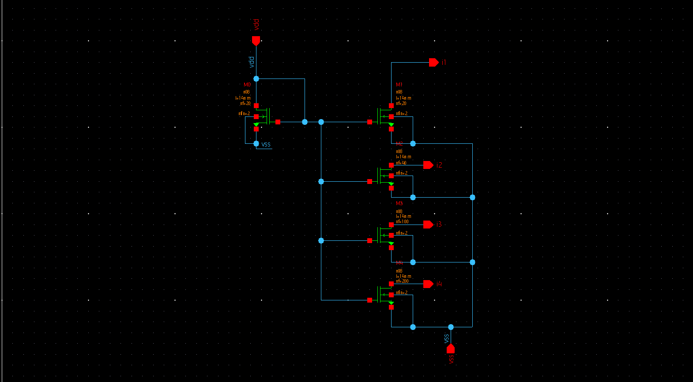
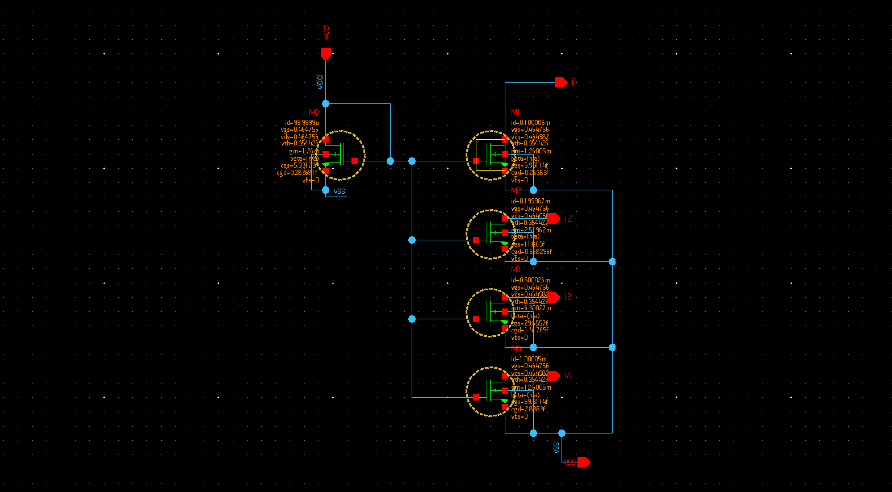
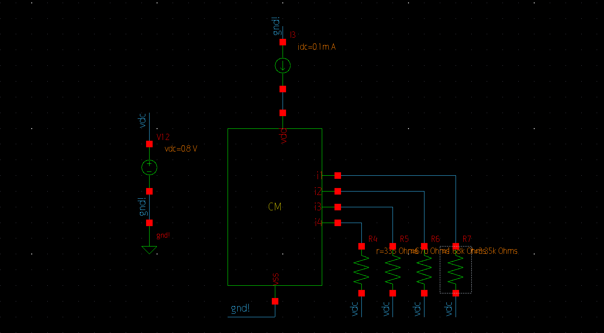
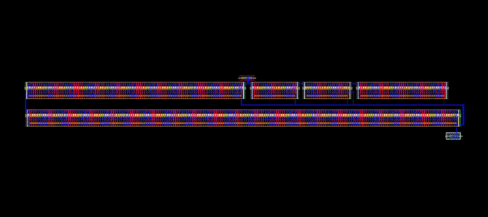
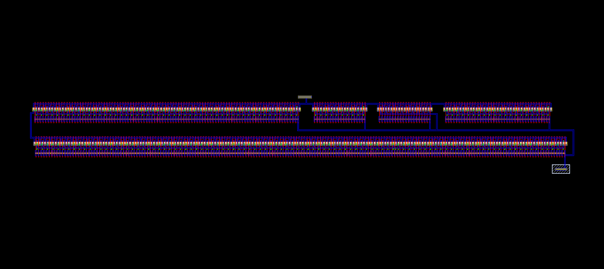

# 14nm FinFET Programmable Current Mirror

Programmable current mirror designed in **14nm FinFET** technology (SAED_PDK_14) using **Synopsys Custom Compiler**.  
Full custom design flow completed: Schematic → Layout → StarRC Parasitic Extraction.

**Key Achievement:** Current matching accuracy better than **0.02%** across 1× / 2× / 5× / 10× branches.

---

## Design Overview

A multi-ratio NMOS current mirror implemented using fin/finger scaling in 14nm FinFET process.

| Branch | Ratio | Number of Fingers | Target Current |
|--------|-------|-------------------|----------------|
| i1     | 1×    | 20                | 100 µA         |
| i2     | 2×    | 40                | 200 µA         |
| i3     | 5×    | 100               | 500 µA         |
| i4     | 10×   | 200               | 1 mA           |

- Technology Node     : 14nm FinFET (SAED_PDK_14)
- Device Type         : n08 (NFET)
- Channel Length      : 14 nm
- Number of Fins      : 2
- Supply Voltage      : 0.8 V
- Reference Current   : 100 µA

---

## Schematic

### Current Mirror Core

### Operating Point Results

Excellent matching is observed between ideal ratios and simulated currents.

---

## Testbench

- Reference current source: 0.1 mA  
- Supply: 0.8 V  
- Resistive loads used for output branches

---

## Layout

Full custom layout created in Synopsys Custom Compiler with proper multi-finger FinFET placement and matching techniques.

---

## Parasitic Extraction (StarRC)

Post-layout parasitic extraction performed using **Synopsys StarRC**.

---

## Tools Used

- **Synopsys Custom Compiler** – Schematic & Layout
- **Synopsys StarRC** – Parasitic Extraction
- **SAED_PDK_14** – 14nm FinFET Process Design Kit

---

## Results Summary

- Current matching accuracy: **< 0.02%**
- Full physical design flow completed (Schematic → Layout → Extraction)
- Proper finger scaling used for precise current ratios
- Clean and matched layout implementation

---

## Author

**Bejish S**  
VLSI Design & Technology  
Chennai Institute of Technology  

[GitHub](https://github.com/bejish) · [LinkedIn](https://www.linkedin.com/in/bejish)
